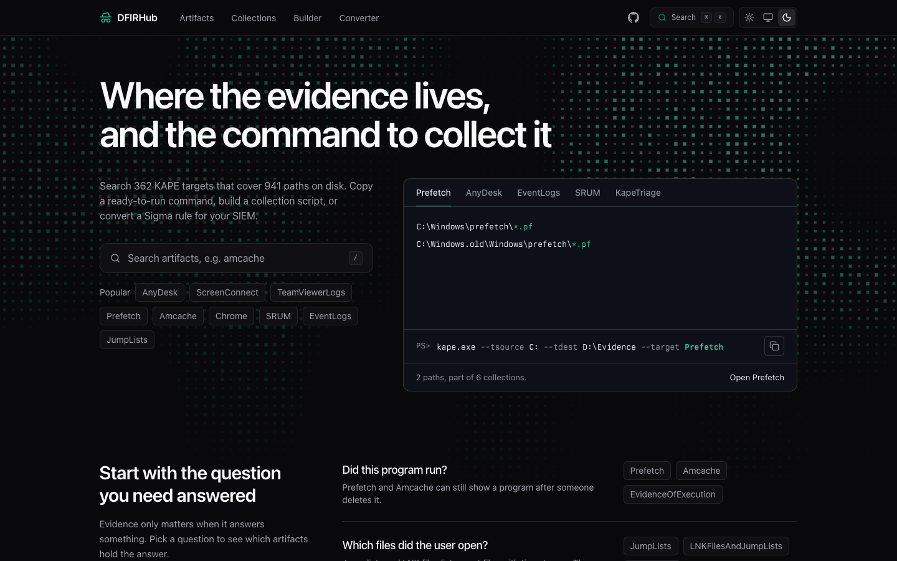

# DFIRHub

DFIRHub is a reference for Windows forensic artifacts. It lists the KAPE targets from Eric Zimmerman's KapeFiles repository, shows what each one collects, and gives you the command to run. It also converts Sigma rules into queries for your SIEM.



## What it does

You can search artifacts by name, or start from a question on the home page, such as "Did this program run?". Each artifact page lists the paths KAPE collects, adds notes, and links to CyberChef recipes for the data inside. A side panel builds the collection command for KAPE, PowerShell, Batch, or WSL.

Collections group related artifacts. The KAPE command builder starts from an incident scenario, combines targets and modules, and exports a KAPE command, a `_kape.cli` batch file or a fallback script; its URL keeps every choice except secrets. Short links open an artifact directly: `/prefetch` works for popular ones, and `/a/<slug>` works for every artifact.

The converter turns a Sigma rule into one of 17 backends, including Splunk, Elastic, KQL, Loki, and CrowdStrike. It runs pySigma in the browser through Pyodide. You can also search the SigmaHQ repository and import a rule from the results.

The site is dark by default. The header switch also offers a light theme and an auto setting that follows your browser. Every artifact page has its own social preview image, rendered at build time.

## Getting started

You need Node 24 and pnpm 10. The KapeFiles data is a git submodule, so initialize it after you clone.

```bash
git clone https://github.com/LasCC/DFIRHub.git
cd DFIRHub
git submodule update --init --recursive
pnpm install
pnpm dev
```

Open `http://localhost:4321`.

## Commands

| Command                | Description                                                                         |
| ---------------------- | ----------------------------------------------------------------------------------- |
| `pnpm dev`             | Start the development server                                                        |
| `pnpm build`           | Build the site. It also renders a social image per artifact, about 90 seconds total |
| `pnpm preview`         | Serve the production build locally                                                  |
| `pnpm test`            | Run the tests                                                                       |
| `pnpm astro check`     | Type check the project                                                              |
| `pnpm check`           | Lint and check formatting with Ultracite                                            |
| `pnpm fix`             | Fix lint and formatting problems                                                    |
| `pnpm run sigma:index` | Rebuild the Sigma rules index from SigmaHQ                                          |

## Project structure

```
src/
├── components/
│   ├── artifact/     # Artifact page: paths, command generator, CyberChef links
│   ├── artifacts/    # Category filters for the artifact list
│   ├── builder/      # KAPE command builder
│   ├── converter/    # Sigma rule converter UI
│   ├── home/         # Landing page sections
│   ├── layout/       # Header, footer, shader background, keyboard shortcuts
│   ├── search/       # Pagefind search
│   └── ui/           # Shared UI primitives and code blocks
├── content/kapefiles # KapeFiles git submodule
├── hooks/            # Theme and clipboard hooks
├── layouts/          # Base page layout and SEO tags
├── lib/              # KAPE data, command generators, social card renderer
│   └── sigma/        # Sigma converter engine (Pyodide worker, backends, pipelines)
├── pages/            # Astro file-based routing, including /og/<slug>.png
└── styles/           # Global Tailwind styles
```

## Deployment

The site deploys to Netlify. Two GitHub Actions workflows keep the data current. Both need a `NETLIFY_BUILD_HOOK` secret, which you create under Build hooks in Netlify and add to the repository secrets in GitHub.

| Workflow                 | Schedule                 | What it does                                                                            |
| ------------------------ | ------------------------ | --------------------------------------------------------------------------------------- |
| `update-kapefiles.yml`   | Weekly (Mon 00:00 UTC)   | Triggers a Netlify rebuild to pull the latest KapeFiles submodule                       |
| `update-sigma-rules.yml` | Monthly (1st, 02:00 UTC) | Rebuilds the Sigma rules index from the SigmaHQ API, commits it, and triggers a rebuild |

You can also start either workflow by hand with `workflow_dispatch`.

## Keyboard shortcuts

| Shortcut       | Action                             |
| -------------- | ---------------------------------- |
| `/` or `Cmd+K` | Open search                        |
| `Cmd+Shift+K`  | Open Sigma search (converter page) |
| `g h`          | Go to home                         |
| `g a`          | Go to artifacts                    |
| `g c`          | Go to collections                  |
| `g b`          | Go to builder                      |
| `g s`          | Go to converter                    |
| `j` / `k`      | Move down / up in a list           |
| `?`            | Show all shortcuts                 |

## Built with

[Astro](https://astro.build) and React, [Tailwind CSS](https://tailwindcss.com), [Pagefind](https://pagefind.app), [Pyodide](https://pyodide.org), [Satori](https://github.com/vercel/satori) for the social images, and [Netlify](https://netlify.com).

## License

[MIT](LICENSE)

## Acknowledgments

- [Eric Zimmerman](https://github.com/EricZimmerman) wrote KAPE and maintains KapeFiles.
- [SigmaHQ](https://github.com/SigmaHQ/sigma) maintains the Sigma detection rules.
- [pySigma](https://github.com/SigmaHQ/pySigma) is the conversion engine.
